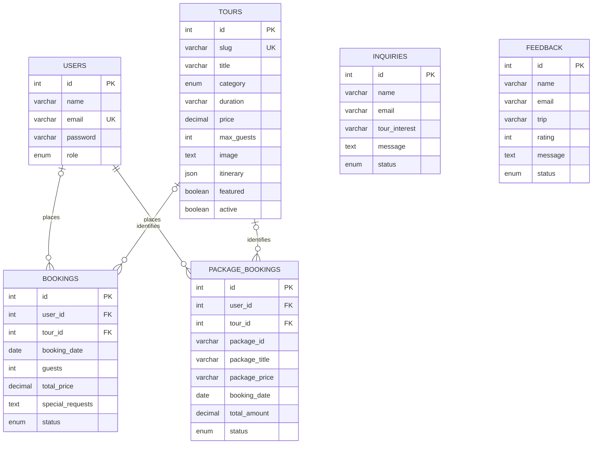

# Database design

- `id` columns are auto-incrementing primary keys; emails and tour slugs are unique.
- Numeric prices and totals use `DECIMAL(10,2)`. Guest counts are integers, dates use `DATE`, and itineraries use MySQL JSON.
- Package bookings retain title, route and price snapshots so changing a tour does not rewrite historical booking details. The authoritative current price comes from `tours`.
- Both booking tables reference `tours` with restricted deletion. The server also checks booking references before deleting a tour. Hiding a tour preserves history.
- Nullable links accommodate older historical records. New authenticated bookings always resolve a real user and tour.
- The older `trips` table and legacy booking columns are retained for compatibility. Current tour selection never treats a legacy trip ID as a current tour ID.
- `schema_migrations` records the one-time catalogue import. Deleted starter packages are not recreated at each restart.

The authoritative table definitions and compatibility migrations are in `backend/src/db.js` and `backend/src/migrations/`.
